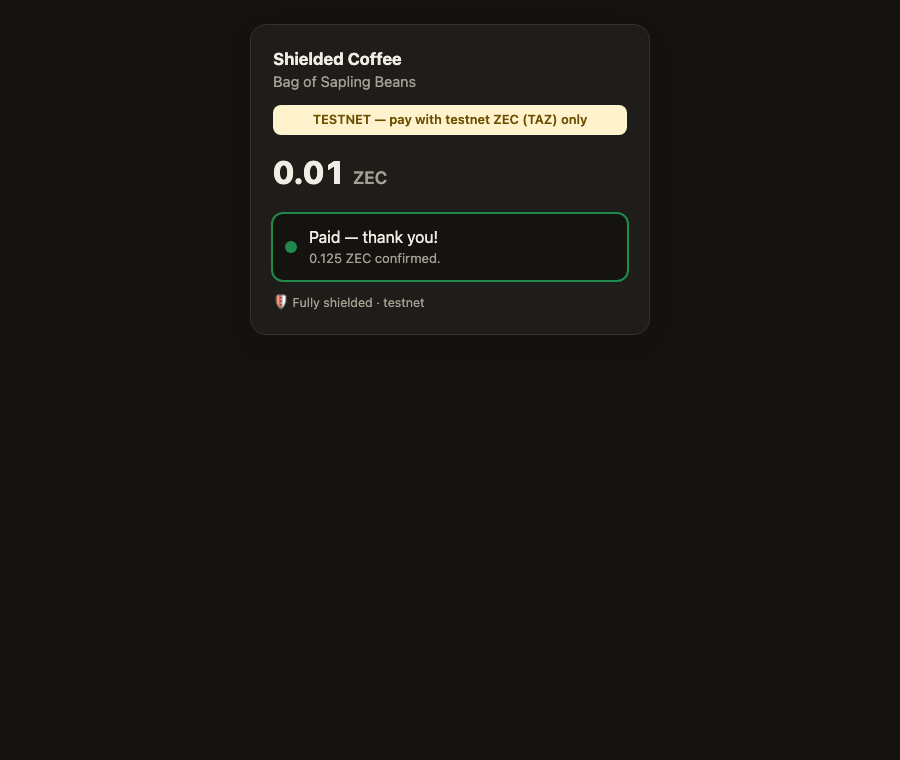
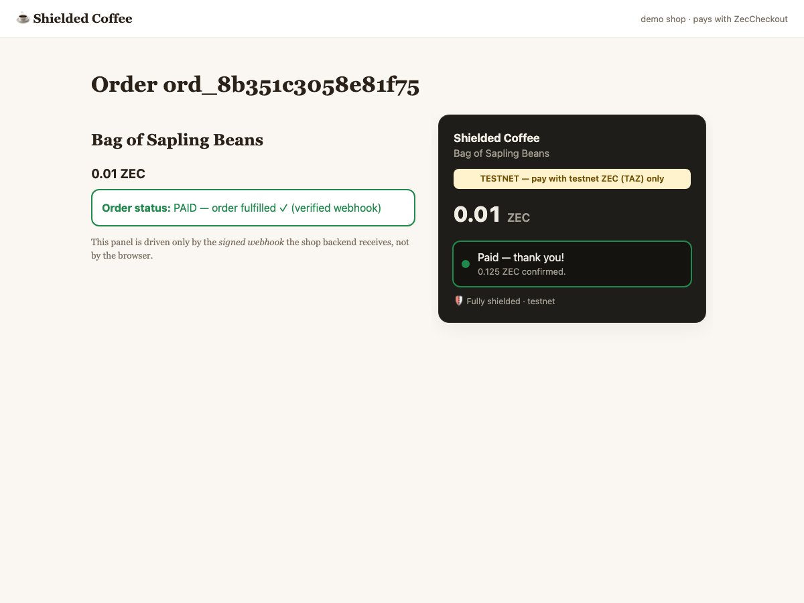

# ZECATHON submission — Shielded Payments track

**Project:** ZecCheckout
**Repo:** <PUBLIC REPO URL — fill in after publishing>
**Demo video:** <VIDEO URL>
**License:** MIT

## One-liner

A self-hosted, shielded-only Zcash checkout: invoices as ZIP-321 QR codes on per-invoice diversified addresses, payment detection by local trial decryption of compact blocks, and HMAC-signed webhooks — with a server that holds only a viewing key.

## What it does

Merchants run one small Rust binary next to their shop. Their backend calls `POST /api/v1/invoices`; ZecCheckout derives a fresh diversified Unified Address (Orchard + Sapling receivers, never transparent) from the merchant's UFVK, returns a ZIP-321 payment URI and a hosted checkout page / embeddable widget with a QR code. A background scanner streams compact blocks from lightwalletd, trial-decrypts every Sapling output and every Orchard and Ironwood (NU6.3) action with the viewing key, maps each hit back to its invoice by diversifier index, moves the invoice through `pending → underpaid/detected → paid` after N confirmations (with reorg rollback), and delivers an HMAC-SHA256-signed webhook from a persistent outbox with retries. A demo coffee shop shows the full integration.

## Privacy by design

- **No spending key on the server** — only a UFVK; a breach leaks history, not funds. The server refuses anything that looks like a seed or spending key.
- **Shielded only** — addresses never contain a transparent receiver; the ZIP-321 builder rejects transparent-only addresses.
- **Nothing per-transaction is ever requested from lightwalletd** — matching uses diversified addresses rather than memos, so we never call `GetTransaction`; the operator sees only a client downloading every block (and the whole mempool), like any light wallet.
- **Unlinkable invoices** — different customers get diversified addresses that cannot be linked to each other or to the merchant's main address.
- **No third parties in the browser** — no CDNs, fonts or analytics; strict CSP (`default-src 'none'`), `no-referrer`, no cookies.
- **Minimal data** — no request/IP logging, no memos downloaded or stored, webhooks carry no addresses/txids; outputs not belonging to invoices aren't recorded.
- **Documented threat model** — what the lightwalletd operator can and cannot learn/do, with the recommendation to self-host lightwalletd/Zaino or use Tor.

## Execution

- Rust, on the official librustzcash crates (`zcash_keys`, `zip321`, `orchard`, `sapling-crypto`, `zcash_client_backend` gRPC/protos).
- 26 automated tests incl. real Sapling/Orchard/Ironwood note encryption to invoice addresses, reorg handling, and an HTTP end-to-end test through to a verified signed webhook; a live test scans 1,500 real testnet blocks with hash-chain verification. `cargo clippy` clean.
- Hardening found by tests: malformed compact outputs from a hostile lightwalletd would panic upstream conversions — ZecCheckout validates lengths first.

## Proven on testnet with a real wallet payment

On 2026-10-09 the Valar testnet faucet (a real zecd wallet, no memo) paid 0.125 TAZ to a demo-shop invoice address. Txid: `24dcd0354daac6af940e63bcf8275e2cbbbf6bf3c8c9f0be111a0338863f5404`, block 4481341. ZecCheckout matched the payment by diversifier index and marked invoice `3267a523…` paid. The shop verified the signed `invoice.paid` webhook 1.8 s later and fulfilled the order.

The run also found a real bug. Since NU6.3, which is active on testnet and on mainnet, every payment to an Orchard receiver arrives as an Ironwood output. That is a consensus rule. The scanner was not reading the Ironwood pool. It was fixed the same day (Ironwood actions are trial-decrypted with the Orchard IVK under the v3 domain, with a test), and the rescan detected the payment. Full timeline, logs and screenshots: [`docs/demo/TESTNET_RUN.md`](demo/TESTNET_RUN.md).

## Originality

Common approaches to Zcash merchant payments involve custodial processors, transparent addresses, or memo-based matching (which requires fetching full transactions and tells the server which transactions matter). ZecCheckout combines viewing-key-only operation, per-invoice diversified addresses as the matching primitive, and merchant-grade plumbing (signed webhooks, outbox, embeddable widget) in a single self-hostable binary.

## AI disclosure

Built with substantial assistance from an AI coding assistant (Claude, via Claude Code) for API research, code, tests and docs; human-directed and reviewed. All code written during the event.
